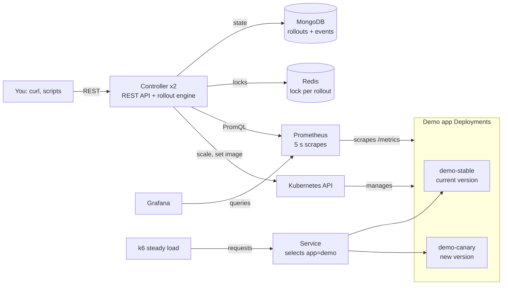
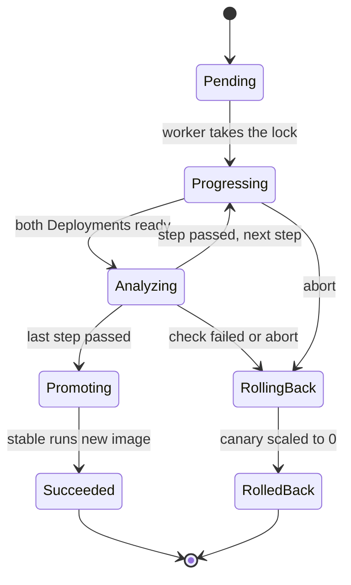

# Design

This is the source of truth for how canary-controller works. Claude Code reads it every session; change it here first when a decision changes.

## Architecture



The controller never touches traffic directly. It scales Deployments through the Kubernetes API and asks Prometheus whether the canary is healthy.

## Traffic splitting: replica ratios, no service mesh

Two Deployments, `demo-stable` and `demo-canary`, both carry the label `app: demo`. One Service selects `app: demo`, so requests spread across ready pods of both, and the traffic share roughly equals the replica share. Total replicas: 10.

| Step | Canary weight | demo-canary pods | demo-stable pods |
| --- | --- | --- | --- |
| Start | 0% | 0 | 10 |
| 1 | 10% | 1 | 9 |
| 2 | 50% | 5 | 5 |
| 3 | 100% | 10 | 0 |
| Promote | — | 0 | 10 (now on the new image) |

Known limits:

- **Coarse:** with 10 pods, 10% is the smallest step.
- **Per connection, not per request:** kube-proxy balances connections. The load generator must open new connections (k6 `noConnectionReuse`) or the split skews.
- **No HPA:** an autoscaler on either Deployment would fight the controller.

Gateway API or a service mesh would fix the first two; that's a stretch goal.

## Rollout lifecycle: reconcile, don't replay

The rollout's desired state (current step, phase) lives in MongoDB. Every loop, the controller makes the cluster match it. Applying the same step twice changes nothing, so a crashed controller can simply resume from the stored state.



Capacity must never drop:

- **Promote:** set demo-stable's image to the new image, scale it to 10, wait until ready, then scale demo-canary to 0.
- **Roll back or abort:** scale demo-stable back to 10 first, wait until ready, then scale demo-canary to 0.

- **Within a step:** grow whichever Deployment needs more pods first, wait until it is ready, and only then shrink the other one. Moving from 10/0 to 9/1 means canary to 1, wait, then stable to 9.

Wait for both Deployments to report their desired ready replicas before judging a step. "Ready at N" means `observedGeneration ≥ generation` and `replicas`, `updatedReplicas`, `readyReplicas` and `availableReplicas` all equal N, so a status read just after a patch is never mistaken for the new state.

### How the engine reconciles

A worker scans active rollouts every 2 s (`ENGINE_INTERVAL`), least recently updated first, and reconciles each one with a 10 s deadline. Each reconcile reads the stored rollout and both Deployments, then does at most one thing: one patch, one phase change, or nothing yet. Doing it twice changes nothing, and phase changes are written only after the cluster has reached the state, so a restarted controller simply continues.

| Phase | Reconcile does | Next |
| --- | --- | --- |
| Pending | Record demo-stable's current image as `stableImage`, set `owner` | Progressing, step 0 |
| Progressing | Set demo-canary's image; canary = round(10 × weight / 100), stable = 10 − canary, applied with the capacity-safe order above | Analyzing when both are ready |
| Analyzing | Re-apply the step's replica counts if they drifted, then ask the analyzer | Next step, Promoting after the last, RollingBack on fail |
| Promoting | Stable to the new image and 10 pods, then canary to 0 | Succeeded |
| RollingBack | Stable back to `stableImage` (in case promotion had started) and 10 pods, then canary to 0 | RolledBack |

Until Phase 5 the analyzer is a fixed wait: a step passes once `interval × checksPerStep` has passed since it became ready.

**Safety nets.** If a step or a promotion is not ready within `maxWait` (for example an image that cannot be pulled), the rollout goes to RollingBack with the reason. If demo-stable or demo-canary is missing, or RBAC forbids access, the rollout ends as RolledBack before touching anything. A version conflict on a write means someone else changed the rollout first; the engine skips that tick and re-reads.

**Two engines at once.** While a controller pod is being replaced, the old pod keeps running through its preStop pause while the new one starts, so two engines can briefly reconcile the same rollout. The version check rejects whichever writes second. Phase 6 adds per-rollout Redis locks so this stops happening.

## Analysis rules

The demo app labels its own metrics with `track` (`stable` or `canary`), set from the `TRACK` env var. The controller runs these queries for each track over a 1-minute window:

```promql
# error rate
sum(rate(http_requests_total{track="canary",code=~"5.."}[1m]))
  / sum(rate(http_requests_total{track="canary"}[1m]))

# p99 latency (seconds)
histogram_quantile(0.99,
  sum by (le) (rate(http_request_duration_seconds_bucket{track="canary"}[1m])))

# request count in the window
sum(increase(http_requests_total{track="canary"}[1m]))
```

Each check returns pass, fail or inconclusive. `decide(settings, stable, canary)` is a pure function applying these rules in order:

1. Canary served fewer than `minRequests` in the window → **inconclusive** (too little data).
2. Canary error rate ≥ `maxErrorRate` and ≥ stable's + `errorMargin` → **fail**.
3. Canary p99 ≥ `maxP99Ms` and ≥ stable's × `latencyFactor` → **fail**.
4. Stable is also over `maxErrorRate` or `maxP99Ms` → **inconclusive** (a shared problem: don't promote, and don't blame the canary).
5. Otherwise → **pass**.

A step passes after `checksPerStep` passing checks in a row. `failureLimit` failures trigger a rollback. Inconclusive for longer than `maxWait` also rolls back, with the reason recorded.

| Setting | Starting value | Why |
| --- | --- | --- |
| interval | 20 s | Time between checks |
| checksPerStep | 3 | About 1 minute of evidence per step |
| failureLimit | 1 | Fast rollback; raise to 2 if checks flap |
| maxErrorRate | 0.02 | 2% errors |
| errorMargin | 0.01 | Canary must be clearly worse than stable |
| maxP99Ms | 500 | The demo app normally answers in a few ms |
| latencyFactor | 1.5 | Canary p99 at least 1.5× stable's |
| minRequests | 50 | Avoids judging on a handful of requests |
| maxWait | 5 min | Inconclusive cap per step |

These are starting values, not tuned ones; Phase 8 tunes them. Prometheus scrapes every 5 s, so a 1-minute window covers 12 scrapes.

## Kubernetes access (RBAC)

The controller's ServiceAccount (`canary-system/controller`) gets a Role in each namespace it may roll out in, currently only `default`:

| Resource | Verbs |
| --- | --- |
| `deployments` | `get`, `patch` (read status, set the container image) |
| `deployments/scale` | `get`, `patch` (set replicas) |

Nothing else: no `list`, `create`, `update` or `delete`, no pods or Secrets, no other namespace. Replica changes are merge patches on the `scale` subresource; image changes are strategic-merge patches on the one container (or the one named after the app). Deployments are found by name: `<app>-stable` and `<app>-canary`.

## Data model (MongoDB)

**`rollouts`**

| Field | Type | Notes |
| --- | --- | --- |
| `_id` | ObjectID | Rollout id |
| `namespace`, `app` | string | Target, e.g. `default`, `demo` |
| `stableImage`, `canaryImage` | string | Images before and after |
| `steps` | []int | Weights, e.g. `[10, 50, 100]` |
| `currentStep` | int | Index into `steps` |
| `phase` | string | One of the lifecycle phases above |
| `analysis` | object | The settings above |
| `lastCheck` | object | Time, both tracks' error rate and p99, verdict |
| `active` | bool | True until Succeeded or RolledBack |
| `owner` | string | Replica holding the lock |
| `version` | int | Optimistic concurrency / fencing token |
| `reason` | string | Why it rolled back, if it did |
| `stepStartedAt` | time | When the current step became ready (start of its analysis) |
| `waitingSince` | time | When the engine started waiting for pods to become ready; compared with `maxWait` |
| `createdAt`, `updatedAt`, `finishedAt` | time | |

**`events`**: `rolloutId`, `at`, `type`, `message`, `metrics`. The audit trail; every phase change, check and rollback writes one.

**Indexes**

- Unique partial index on `{namespace, app}` where `active: true`: at most one active rollout per app, enforced by the database. The API maps the duplicate-key error to 409.
- `{active: 1, updatedAt: 1}` for the worker's scan.
- `{rolloutId: 1, at: 1}` on `events`.

**Writes:** every update filters on `{_id, version}` and increments `version`. If nothing matched, someone else changed the rollout first, and this replica stops working on it.

## High availability (Redis)

Each controller replica scans active rollouts every 2 s and tries to lock each one:

- **Acquire:** `SET lock:rollout:<id> <replica-id>:<random> NX PX 15000`
- **Renew:** every 5 s, with a Lua script that extends the TTL only if the value is still yours. If renewal fails, stop working on that rollout at once.
- **Release:** a Lua compare-and-delete.

If a replica dies, its lock expires within 15 s and another replica resumes from MongoDB.

A replica that pauses past its TTL (a long GC pause, a network partition) may still think it owns the lock. The MongoDB version check rejects its stale writes; that is the fencing token. A stale Kubernetes patch could still slip through, and the next owner's reconcile corrects it. Background reading: Martin Kleppmann, "How to do distributed locking".

## REST API

| Method | Path | Does |
| --- | --- | --- |
| POST | `/v1/create-rollout` | Start a rollout: namespace, app, image, steps, analysis settings. 201 with id; 409 if one is active |
| GET | `/v1/rollouts/{id}` | Phase, step, last check |
| GET | `/v1/rollouts?app=demo` | History for an app |
| GET | `/v1/rollouts/{id}/events` | Audit trail |
| POST | `/v1/rollouts/{id}/abort` | Roll back now. 202 from Pending, Progressing, Analyzing or Promoting; 409 otherwise |
| POST | `/v1/rollouts/{id}/promote` | Skip the remaining steps and promote (manual override). 202 from Progressing or Analyzing; 409 otherwise (including Pending, before the stable image is recorded) |
| GET | `/healthz`, `/readyz`, `/metrics` | Probes and Prometheus metrics |

Example request:

```json
POST /v1/create-rollout
{
  "namespace": "default",
  "app": "demo",
  "image": "demo:v2-bad",
  "steps": [10, 50, 100],
  "analysis": { "interval": "20s", "checksPerStep": 3, "maxErrorRate": 0.02 }
}
```

Creating uses its own path, `POST /v1/create-rollout`; everything else lives under `/v1/rollouts`, and the 201 response's `Location` header points to `/v1/rollouts/{id}`. `POST /v1/rollouts` returns 405.

Fields left out of `analysis` take the starting values above. Use Go's standard `net/http` router (method and path patterns, Go 1.22+); no web framework.

**Validation** (400 with per-field messages):

- `namespace`, `app`: Kubernetes names (lowercase letters, digits, `-`; at most 63 characters).
- `image`: required, no whitespace.
- `steps`: 1 to 10 weights, each a multiple of 10 (one pod out of 10) between 10 and 100, strictly increasing. The last step need not be 100; the rollout promotes after it.
- `analysis`: `interval` ≥ 5 s (the scrape interval), `checksPerStep` and `failureLimit` ≥ 1, `maxErrorRate` and `errorMargin` in 0–1, `maxP99Ms` > 0, `latencyFactor` ≥ 1, `minRequests` ≥ 0, `maxWait` ≥ `interval`.
- Unknown JSON fields are rejected, so a typo is an error rather than a silently ignored setting. Bodies must be `application/json` (415 otherwise) and at most 1 MB (413).

**Errors** are always `{"error": "...", "fields": {"steps": "..."}}`, with `fields` present only for validation errors.

`stableImage` is empty when a rollout is created; the rollout engine (Phase 4) reads the current stable image from the cluster when the rollout starts. Durations are JSON strings (`"20s"`) in the API and nanoseconds in MongoDB.

Every response carries `X-Request-ID` (the caller's, if valid, else a generated one), and every log line for that request includes it as `request_id`.

## Demo app

| Env var | Meaning | Default |
| --- | --- | --- |
| `VERSION` | Reported in responses | build arg |
| `TRACK` | `stable` or `canary`; metric label | set by the Deployment |
| `ERROR_RATE` | Fraction of `GET /` requests answered with 500 (0 to 1) | build arg, 0 |
| `EXTRA_LATENCY_MS` | Delay added to every `GET /` request | build arg, 0 |

Injection and the `http_*` metrics cover `GET /` only. `/healthz` and `/metrics` stay fast and healthy, so a bad image still becomes ready and probe traffic does not dilute the measured error rate.

Images: `demo:v1`, `demo:v2`, `demo:v2-bad` (20% errors), `demo:v2-slow` (+800 ms). The controller only swaps images; the bad behaviour is baked into the image.
